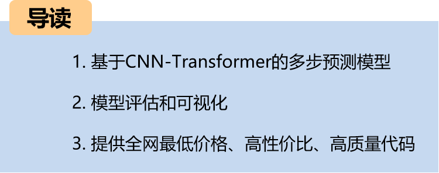
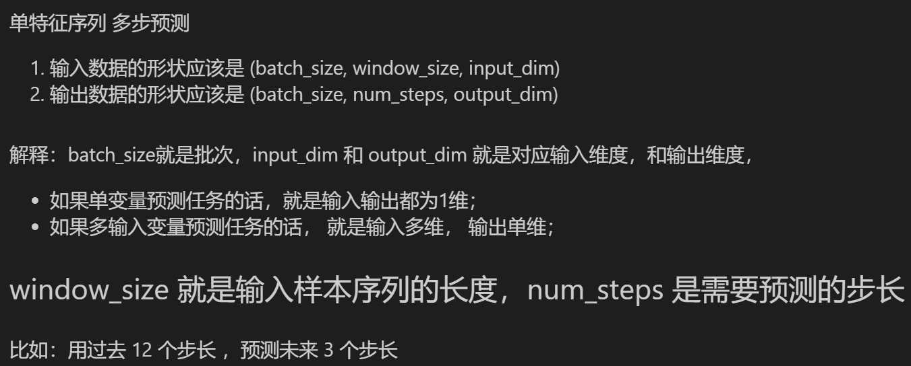
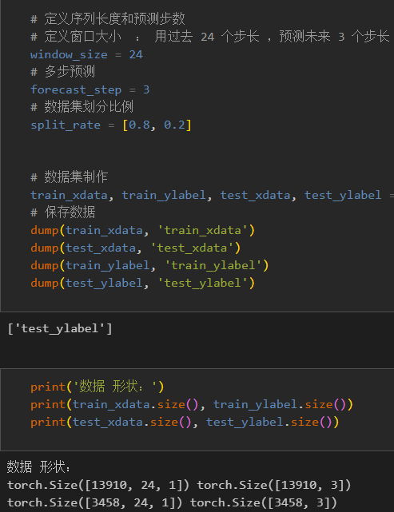
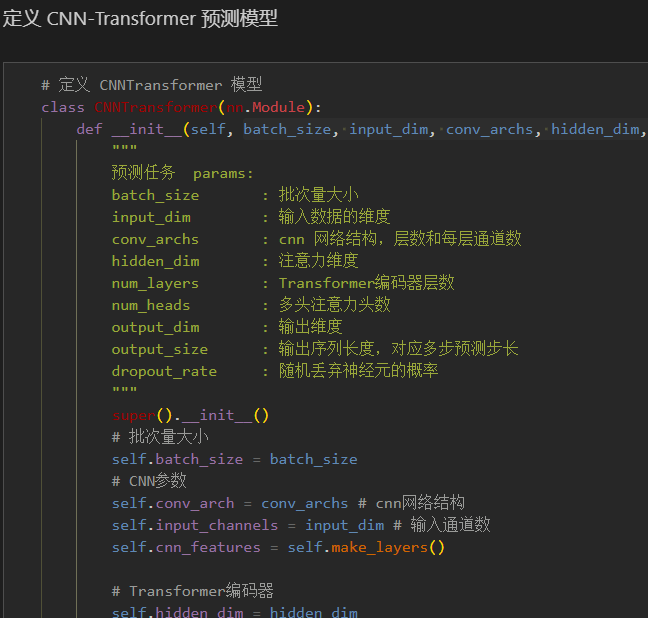
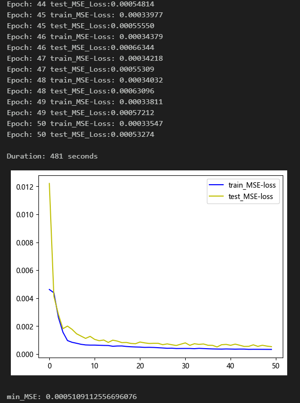
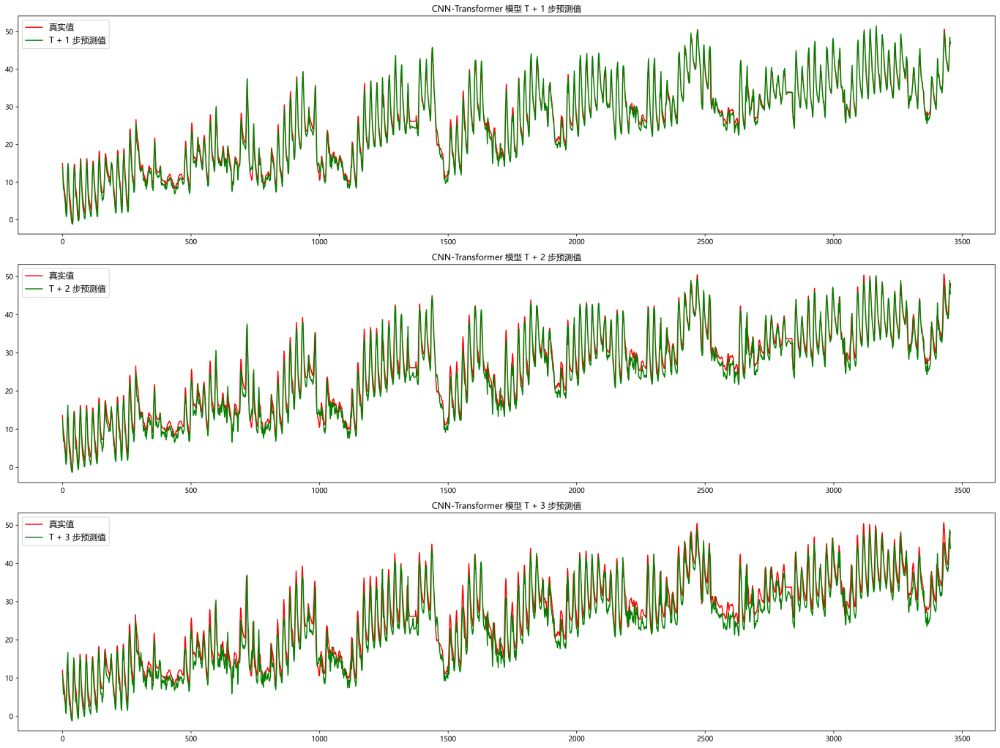
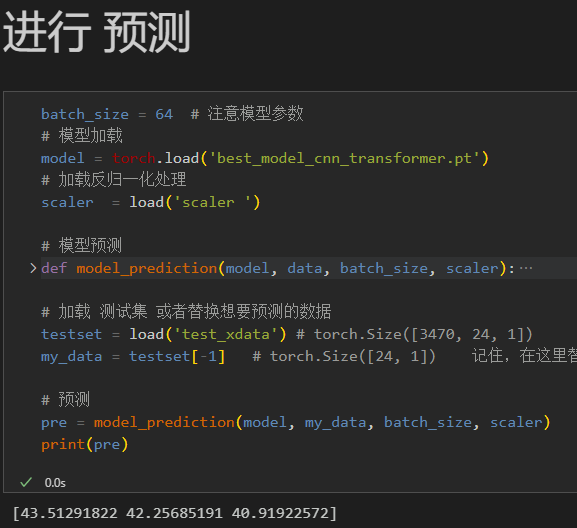
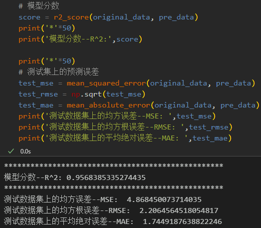
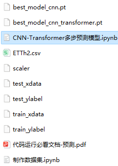

# CNN-Transformer Multi-Step Prediction Model

● Environment Framework: Python 3.9, PyTorch 1.8 and above can be run.
● Usage Object: Paper requirements, graduation design requirements.
● Code Guarantee: The code comments are detailed and ready to run.
Includes complete process data code processing:
Multi-step prediction dataset creation, data loading, model definition, parameter setting, model training, model testing, prediction visualization, multi-step prediction, model evaluation.
Code and file introduction:
Preface
This article is based on the previously introduced power transformer (data set attached at the end of this document), introducing a multi-feature, multi-step prediction model based on the CNN-Transformer network.
The detailed introduction to the power transformer dataset can be found in the following text:
Introduction to the Power Transformer Dataset and Preprocessing
1 Data Preprocessing and Visualization of Electric Power Transformers
1.1 Import data
1.2 Multi-step Preprocessing for Prediction
2. Multi-variable multi-step prediction model based on CNN-Transformer
2.1 Define CNN-Transformer Network Model
\t  
2.2 Set parameters and train the model
50 epochs, MSE is 0.0005109, the multi-step prediction model of CNN-Transformer has a significant effect on prediction. The model can fully extract the spatiotemporal features of sequences, converges quickly, and performs excellently with high accuracy in predictions. By appropriately adjusting the model parameters, further improvement in the model's predictive performance can be achieved.
\tNote: Adjust parameters.
\tIt is appropriate to increase the number of CNN layers and the number of channels per layer.
\tChange the number of Transformer encoder layers and attention dimensions, increase more epochs (note to prevent overfitting)
\tThe sliding window length can be changed (set the appropriate window length).
3 Results Visualization and Prediction, Model Evaluation
3.1 Visualization of Prediction Results
3.2 Loading the model for prediction
3.3 Model evaluation
Previously excellent content:
Time series forecasting: Analysis and comparison of LSTM, ARIMA, Holt-Winters, SARIMA models
Wind speed forecasting (I) Data introduction and preprocessing
Wind speed forecasting (II) EMD-LSTM model based on Pytorch
Wind speed forecasting (III) EMD-LSTM-Attention model
Wind speed forecasting (IV) EMD-Transformer model based on Pytorch
Wind speed forecasting (V) EMD-CNN-LSTM model based on Pytorch
Wind speed forecasting (VI) EMD-CNN-GRU parallel model based on Pytorch
CEEMDAN + combined forecasting model (BiLSTM-Attention + ARIMA)
CEEMDAN + combined forecasting model (CNN-LSTM + ARIMA)
CEEMDAN + combined forecasting model (Transformer - BiLSTM + ARIMA)
CEEMDAN + combined forecasting model (CNN-Transformer + ARIMA)
Multi-feature variable sequence forecasting (I) - CNN-LSTM wind speed forecasting model
Multi-feature variable sequence forecasting (II) - CNN-LSTM-Attention wind speed forecasting model
Multi-feature variable sequence forecasting (III) - CNN-Transformer wind speed forecasting model
Multi-feature variable sequence forecasting (IV) Transformer-BiLSTM wind speed forecasting model
Multi-feature variable sequence forecasting (V) CEEMDAN+CNN-LSTM wind speed forecasting model
Multi-feature variable sequence forecasting (VI) CEEMDAN+CNN-Transformer wind speed forecasting model
Prediction Model Based on the Particle Swarm Optimization Algorithm SSA: CEEMDAN-BiLSTM-Attention
Prediction Model Based on the Particle Swarm Optimization Algorithm SSA: CEEMDAN-Transformer-BiGRU
Superior Prediction Model: Secondary Decomposition-Combination Prediction
Multi-Feature Variable Sequence Prediction (Part 7): CEEMDAN+Transformer-BiLSTM Prediction Model
Multi-Feature Variable Sequence Prediction (Part 8): Prediction Model Based on the Particle Swarm Optimization Algorithm SSA-CEEMDAN-BiLSTM
Multi-Feature Variable Sequence Prediction (Part 11): Prediction Model Based on Pytorch's TCN-GRU
VMD + CEEMDAN: Secondary Decomposition, CNN-LSTM Prediction Model
VMD + CEEMDAN: Secondary Decomposition, CNN-Transformer Prediction Model
VMD + CEEMDAN: Secondary Decomposition, Transformer-BiGRU Prediction Model
Prediction Model Based on the Particle Swarm Optimization Algorithm SSA: Code All-in-One Kit
Introduction to the Power Transformer Data Set and Preprocessing
 | Sci-Tech 1st Class High Innovation Prediction Model!
END

## Images

<!-- PAYMENT_BLOCK -->

## Get this dataset

- Payment link (Stripe): [Buy now](https://buy.stripe.com/3cs8yP7sY87d0vu9AB)
- Payment QR code: 

<!-- /PAYMENT_BLOCK -->
